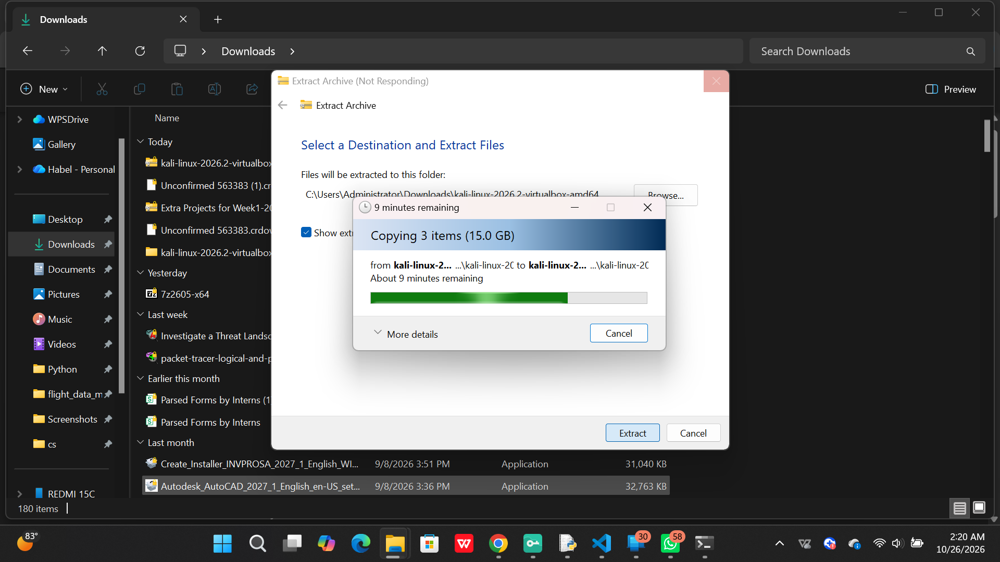

# Kali Linux VirtualBox Lab Setup


## About This Project

This project documents my step-by-step process of setting up a Kali Linux virtual machine using Oracle VirtualBox on Windows. It is a beginner-friendly lab for learning Linux, virtualization, and cybersecurity fundamentals.

## Objectives

- Install and configure Oracle VirtualBox.
- Download and extract the official Kali Linux VirtualBox image.
- Register and configure a Kali virtual machine.
- Configure virtual networking.
- Verify the installation and document the process.
- Build a foundation for future cybersecurity labs.

## Tools and Technologies

- Windows 11
- Oracle VirtualBox
- Kali Linux
- 7-Zip
- Markdown and GitHub

## Setup Guide

### 1. Install VirtualBox

Download VirtualBox from the [official website](https://www.virtualbox.org/wiki/Downloads). Select the Windows host installer, run it, and follow the installation prompts.

### 2. Install 7-Zip

If the Kali download is a `.7z` archive, install [7-Zip](https://www.7-zip.org/) to extract it.

### 3. Download Kali Linux

Visit the [official Kali Linux Virtual Machines page](https://www.kali.org/get-kali/#kali-virtual-machines) and download the pre-built VirtualBox image.

### 4. Extract the Image


Open the Downloads folder, right-click the downloaded archive, and choose **7-Zip → Extract to...**. In the extracted folder, look for the `.vbox` configuration file and `.vdi` virtual disk.

Keep these files together.

### 5. Add the Virtual Machine

Open VirtualBox Manager and choose **Machine → Add**. Browse to the extracted folder, select the `.vbox` file, and confirm.

If your download is an `.ova` file instead, use **File → Import Appliance**.

### 6. Configure the Virtual Machine

Open the VM settings and review the available RAM, CPU, storage, and network options. Start with modest resource allocations so Windows continues to run smoothly.

### 7. Configure Networking

For an initial setup, use **NAT** under **Settings → Network → Adapter 1**. NAT is generally a sensible default for outbound connectivity without directly placing the VM on the physical local network.

### 8. Start Kali Linux

Select the VM and click **Start**. Use the credentials documented for your downloaded image. Some official pre-built images have used `kali` as both username and password, but credentials may vary by release.

### 9. Verify the Installation

Open a terminal in Kali Linux and run:

```bash
whoami
cat /etc/os-release
ip address
```

Record the results and document any setup issues you encounter.

## Repository Structure

```text
kali-virtualbox-lab-setup/
├── README.md

```

## Screenshots

Screenshots of my own setup will be added to `docs/lab-screenshots/` as the lab progresses.

Planned screenshots:

- VirtualBox Manager
- Extracted Kali image files
- Kali VM registered in VirtualBox
- Network settings
- Successfully booted Kali desktop

## Safety Notes

This project is intended for educational use in a controlled environment. Only test systems you own or have explicit permission to assess. Keep software updated and choose network settings appropriate to the lab.

## Troubleshooting

- **Missing `.vbox` file:** Confirm that the archive was extracted successfully.
- **Missing virtual disk:** Keep the `.vbox` and `.vdi` files together.
- **No internet:** Check that the network adapter is enabled and attached to NAT.
- **VM fails to start:** Record the complete error message and consult the official documentation.

## Official References

- [Kali Linux Downloads](https://www.kali.org/get-kali/)
- [Kali Linux Documentation](https://www.kali.org/docs/)
- [Oracle VirtualBox Downloads](https://www.virtualbox.org/wiki/Downloads)
- [Oracle VirtualBox Manual](https://www.virtualbox.org/manual/)
- [7-Zip](https://www.7-zip.org/)

## Learning Progress

This repository will be updated as I complete the installation, capture screenshots, troubleshoot issues, and expand my cybersecurity lab.

## Author

Created as a personal learning and portfolio project for my begining career in cybersecurity.
